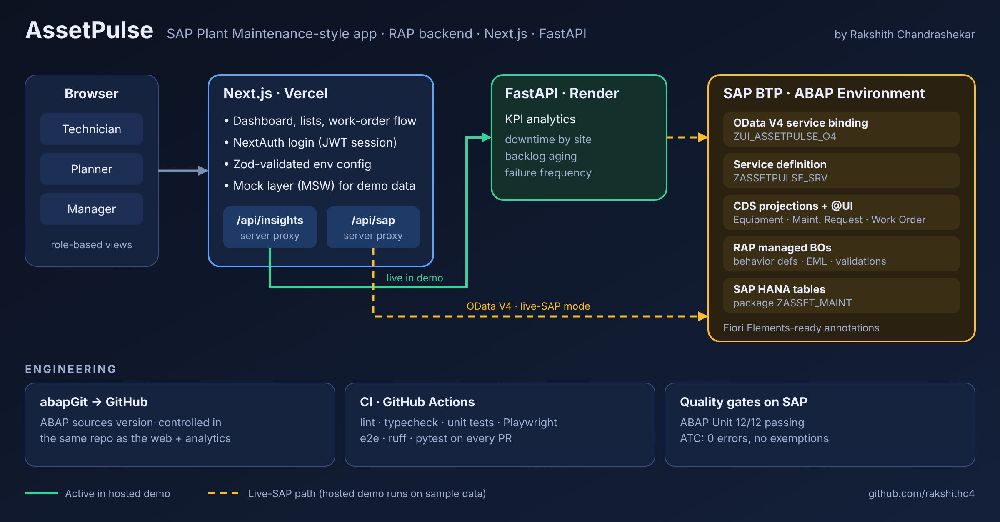
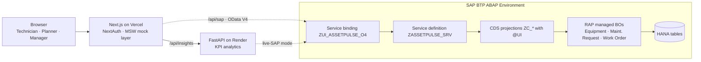

# AssetPulse architecture

The hosted demo runs on sample data. Solid arrows are active in the demo; dashed arrows are the live-SAP path (enabled when pointed at an ABAP system with a communication arrangement).

## Engineering
- **abapGit → GitHub:** ABAP sources live under `abap/` in the same repo as `web/` and `analytics/`.
- **CI (GitHub Actions):** lint, typecheck, unit tests, Playwright e2e for the web app; ruff and pytest for analytics.
- **Quality gates on SAP:** ABAP Unit 12/12 passing, ATC 0 errors.
